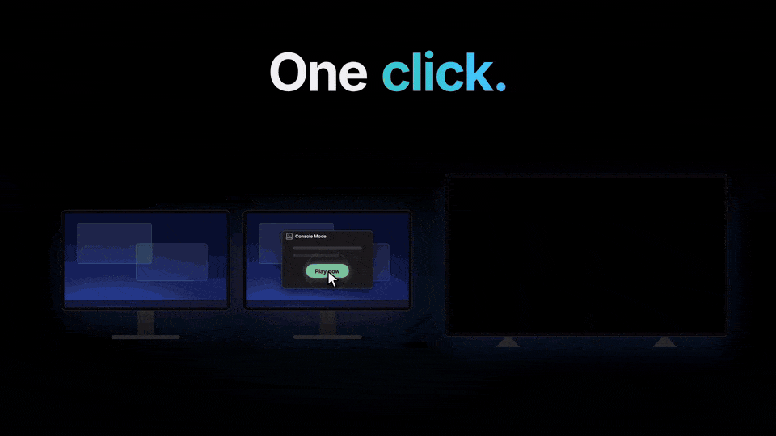

# Console Mode

Transformez votre PC Windows en **console de jeu** en un clic : la TV passe au premier plan, les autres écrans s'éteignent, le son bascule et votre interface de jeu se lance. Quittez le jeu et votre bureau revient tout seul.

[English](README.md) · [Português (Brasil)](README.pt-BR.md) · [Español](README.es-ES.md) · [Deutsch](README.de-DE.md) · Français · [Русский](README.ru-RU.md)

## Téléchargement

Récupérez la dernière version stable sur **[la page des versions](https://github.com/lippdev/consolemode/releases/latest)** :

- **`ConsoleMode-Setup-x64.exe`** (recommandé) : installation par utilisateur, sans droits administrateur, mises à jour automatiques.
- **`ConsoleMode-Portable-x64.exe`** : un seul exe qui garde ses données à côté de lui.
- Ou avec winget : `winget install lippdev.ConsoleMode`

Envie d'essayer la suite avant tout le monde ? Activez Paramètres → « Recevoir les versions de test (alpha et bêta) ».

Windows 10 ou 11, plus [Steam](https://store.steampowered.com/) (Big Picture), [Playnite](https://playnite.link/) ou l'application Xbox. [RTSS](https://www.guru3d.com/files-details/rtss-rivatuner-statistics-server-download.html) est facultatif, pour la limite de FPS et le compteur de FPS.

## Comment ça marche

1. Ouvrez l'application et choisissez l'écran sur lequel vous jouez. Les autres s'éteignent.
2. Appuyez sur **Jouer**, ou utilisez le raccourci en un clic sur le Bureau. La première fois sur un nouvel écran, la TV demande « Voyez-vous cet écran ? » et revient en arrière toute seule si personne ne répond.
3. Quittez Big Picture ou Playnite et tout revient : écrans, son, résolution.

Plutôt canapé ? Avec l'application dans la zone de notification, maintenez votre raccourci manette et elle démarre depuis là.

C'est vous qui choisissez les raccourcis manette : aucun n'est actif au départ, l'application vous les demande à la première ouverture (et vous pouvez les modifier dans les Paramètres). Un même bouton ne peut pas servir à deux actions.

| Raccourci manette | Action | Suggestion |
|---|---|---|
| Maintenir le raccourci **d'ouverture** | Entrer en mode console depuis la zone de notification | **Home** (Xbox / PS) |
| Maintenir le raccourci **du menu** | Menu par-dessus le jeu : fenêtres ouvertes, explorateur de fichiers, volume, résolution, son, FPS, HDR, sortie | **Select + Y** (Create + △) |
| Maintenir le raccourci **de retour au PC** | Retour au PC | **Start + Select** (Options + Create) |

## Fonctionnalités

- Masquer les autres écrans en les **déconnectant**, avec des **écrans noirs** ou par **DDC/CI**, uniquement avec les API de Windows : aucun outil tiers d'affichage ou de son n'est inclus
- **Résolution et fréquence** par écran, **HDR**, **VRR** et **limite de FPS** (RTSS) pendant que vous jouez
- **Compteur de FPS** par-dessus le jeu (RTSS) sur une carte en trois tailles : FPS seulement, compact (utilisation CPU, GPU et RAM), détaillé (fréquences, température et mémoire du GPU) ou votre propre disposition
- Le son passe sur la TV (ou n'importe quelle sortie) et revient ensuite
- [Allume la TV et la bascule sur l'entrée du PC](docs/GUIDE.fr-FR.md#contrôle-de-la-tv) (Google TV / Android TV par le réseau), et peut la mettre en veille ensuite
- Lance **Steam Big Picture**, **Playnite en plein écran** ou le mode **Xbox**, et réduit Steam dans la zone de notification quand vous revenez au PC
- **Menu de session** par-dessus le jeu : changer de fenêtre ou fermer les fenêtres ouvertes, régler le volume, la résolution, le son, les FPS et le HDR, masquer le pointeur de la souris ou le piloter à la manette, et parcourir vos fichiers avec [ControlFS](https://github.com/nextestudios/ControlFS)
- Deux interfaces : **Bureau** (souris) et **Console** (plein écran, manettes Xbox et PlayStation, onglets sur LB/RB, un fond d’écran maison ou vos jaquettes Steam en fond)
- Automatisation avec les liens `consolemode://start` / `stop` / `menu` (Stream Deck, scripts) et une [API de contrôle local](docs/GUIDE.fr-FR.md#api-de-contrôle-local)
- Anglais, portugais, espagnol, allemand, français et russe

Les nouveautés de chaque version sont dans le [CHANGELOG.en-US.md](CHANGELOG.en-US.md) (en anglais).

## Plus

- [Guide](docs/GUIDE.fr-FR.md) : modes et restauration, API de contrôle, HDR/VRR/FPS, dépannage
- **Commentaires :** le bouton « Envoyer des commentaires » à côté des Paramètres dans l'application, ou [ce formulaire](https://github.com/lippdev/consolemode/issues/new?template=feedback.yml). Une ⭐ aide d'autres joueurs de canapé à trouver le projet.
- Les versions ne sont pas encore signées numériquement, donc Windows SmartScreen ou un antivirus peut afficher un avertissement au téléchargement ; tout le code source est ici.
- **Aider à traduire :** voir [docs/TRANSLATING.md](docs/TRANSLATING.md) (en anglais).

[GNU Affero General Public License v3.0 uniquement](LICENSE) · [Mentions des logiciels tiers](THIRD_PARTY_NOTICES.md) · [Politique de signature du code](docs/CODE_SIGNING.md)

*Cette page est une traduction du README en anglais. En cas de différence, c'est la version anglaise qui fait foi.*
